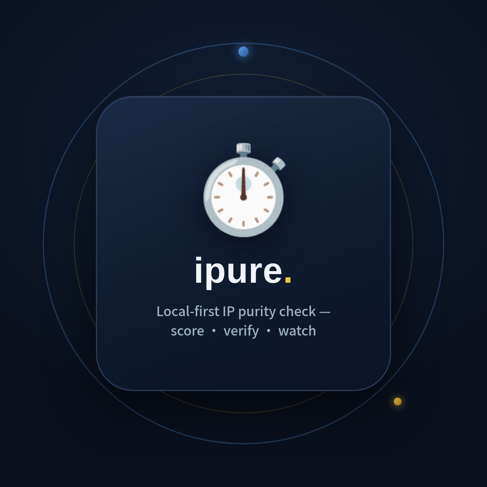
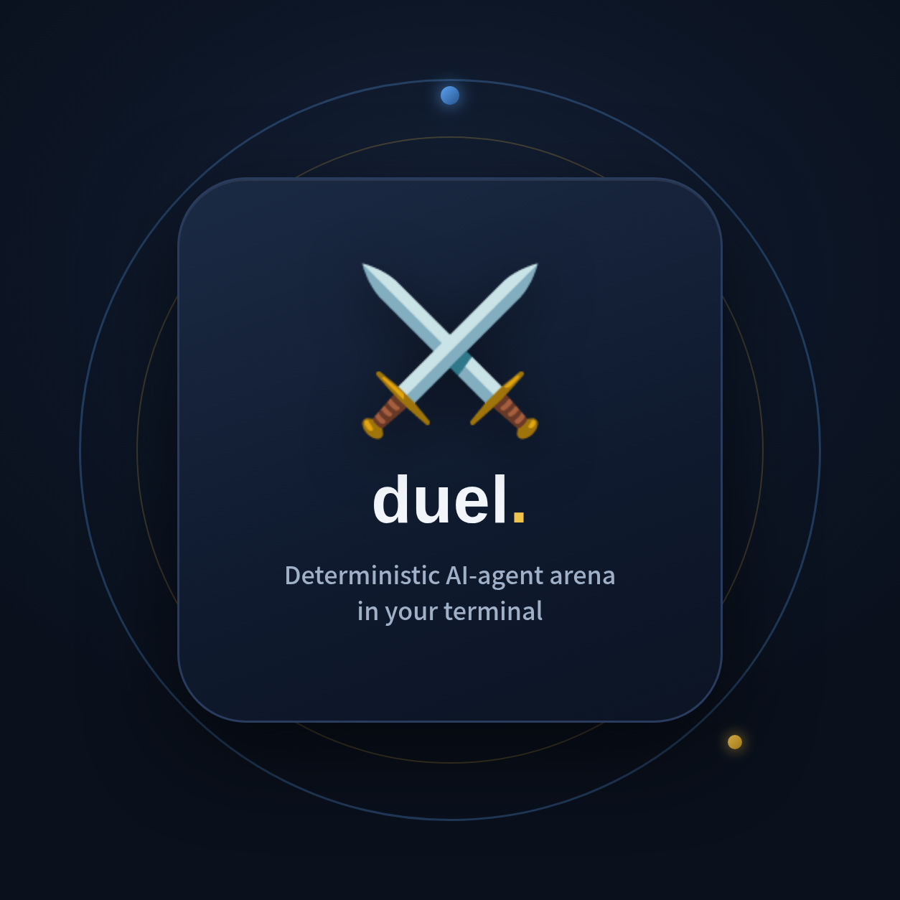
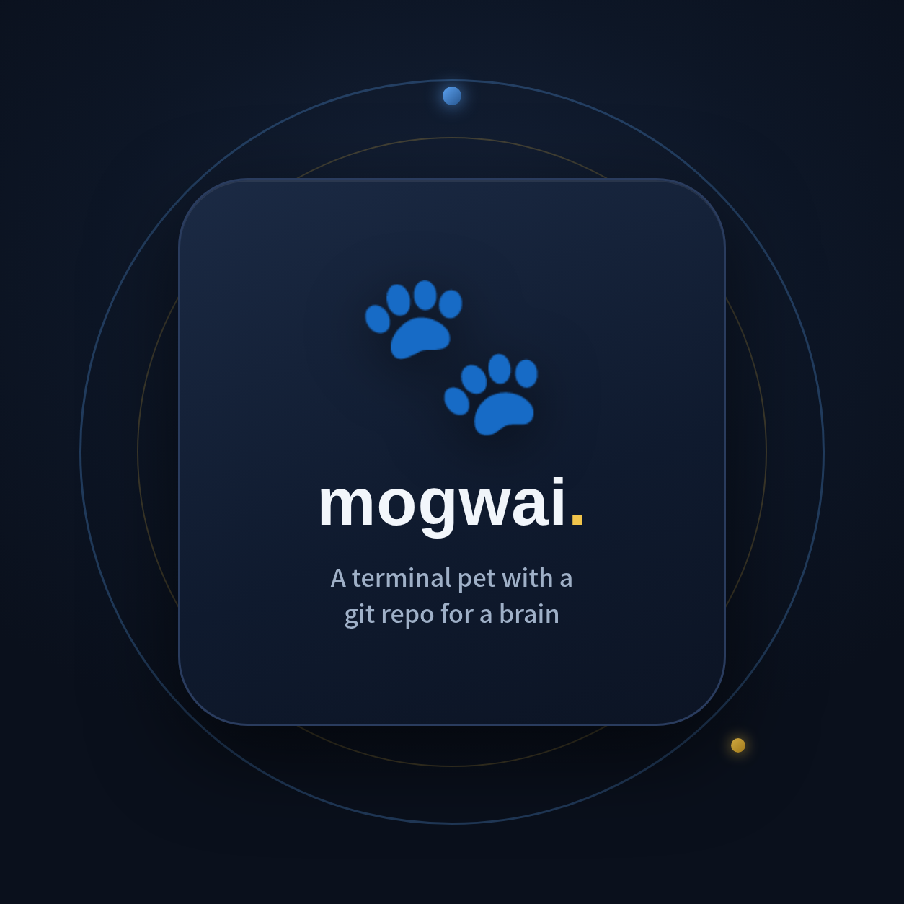
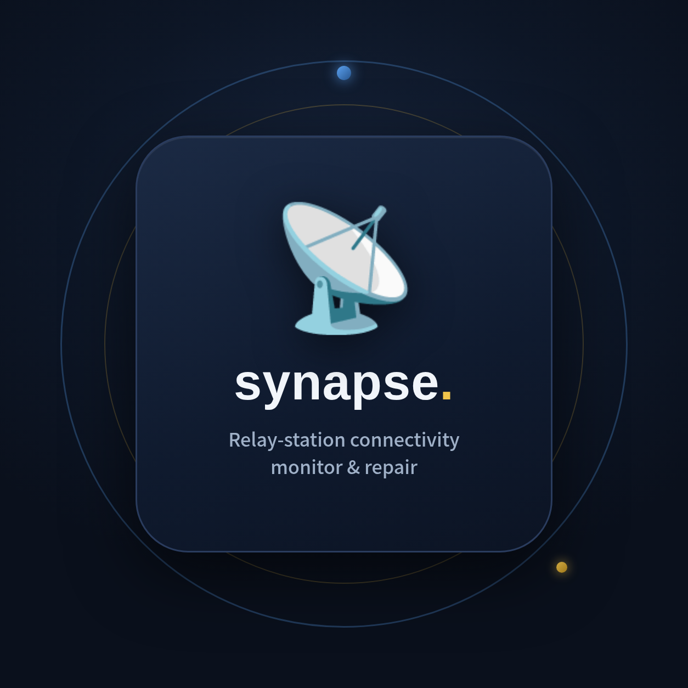
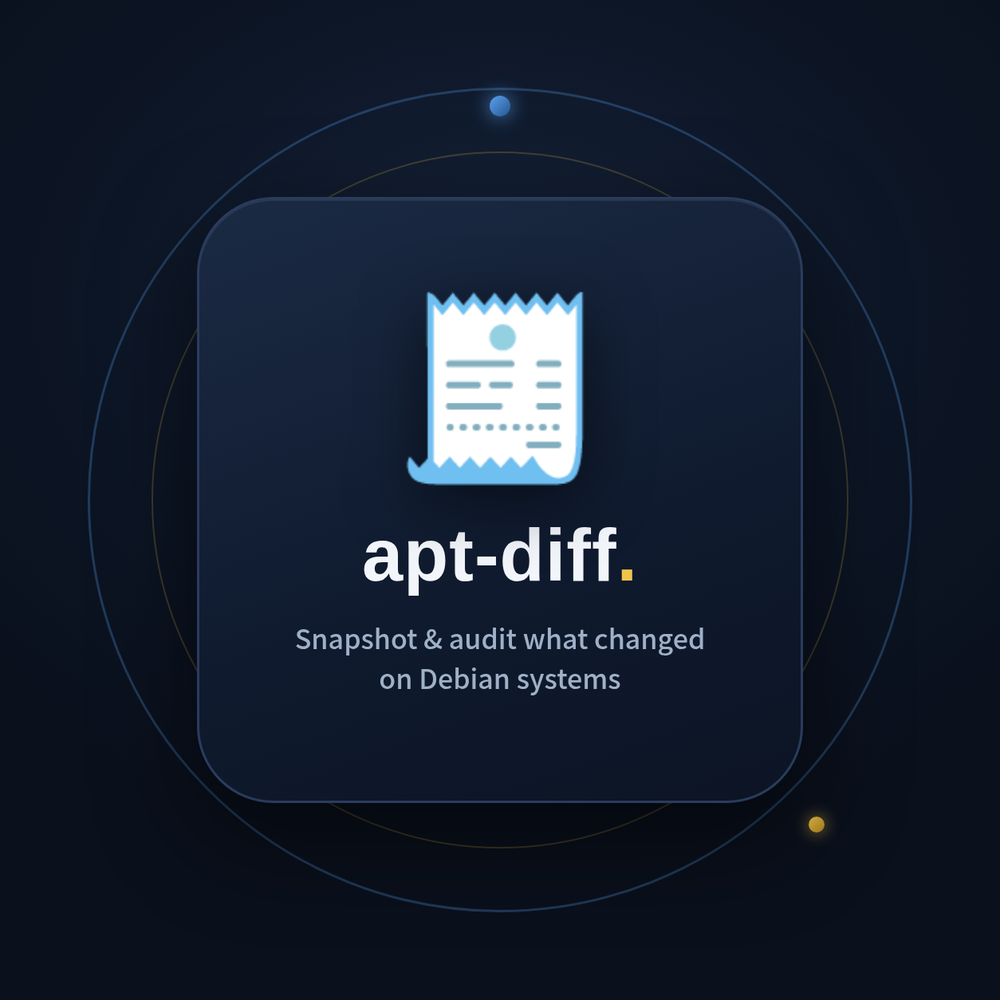

# Jerry Lee · 李佳徽

**B.Eng. candidate in Artificial Intelligence, Wuhan University (2023–2027)**

I build measurement tools — benchmarks that can tell a model which *did* the task
from one that happened to guess right.

[jiahuili@whu.edu.cn](mailto:jiahuili@whu.edu.cn) · [ecoreal.github.io](https://ecoreal.github.io/) · Wuhan, China

## Research

**Benchmark validity for multimodal models.** I co-designed a VLM benchmark for
instrument reading and built its data and evaluation pipeline: **1,821 images, 7
subsets, 32 instrument types**, every value and box annotated by a human. Two
results shaped how I work. Agent-generated ground truth inflates reading accuracy
(**22.4% vs 14.5%**) and flattens prompt effects (+0.11 pp vs +4.12 pp); a
same-model label-and-evaluate loop inflates it by **75%**. And the metric the
project had planned to headline turned out to be an arithmetic identity — it
equals exactly half the whole-image reading accuracy. What survived is `ec_rate`,
the share of correct answers whose localization was wrong: **22.8% (50/219)**.

**Self-evolving data engines.** A five-stage annotation engine for animal pose
(YOLO-World → SAM2.1 → ViTPose++ → CoTracker3 → quad-triage). The design choice
that mattered was making tracking *abstain* rather than propagate unreliable
keypoints: Gold clips **56 → 71**, worst failure class **36 → 24**.

**Label quality in remote sensing.** Morphological filters for OSM-derived road
labels. At an equal budget of 17,802 samples, morphology-based selection raised
recall from **72.18% to 80.15%** over random sampling. Second author.

## Selected work

| Repository | What it is |
| --- | --- |
| [`ipure`](https://github.com/ecoreal/ipure) | Local-first IP purity check — itemised scoring, real-traffic exit verification, duplicate exits, native/broadcast via RIR, DNSBL · [live demo report](https://ecoreal.github.io/ipure/demo-report.html) |
| [`tape`](https://github.com/ecoreal/tape) | Time-travel debugger for AI agent sessions — reads the JSONL your agent already writes, zero dependencies |
| [`agentic-risk-scan`](https://github.com/ecoreal/agentic-risk-scan) | Dependency-free scanner for agent workflows, MCP servers and instruction-file risks |
| [`model-performance-test`](https://github.com/ecoreal/model-performance-test) | Frontend benchmark for LLMs: one prompt, one 100-point rubric, several models |
| [`m2html`](https://github.com/ecoreal/m2html) | Markdown → HTML in Rust, GFM and syntax highlighting, with CLI and Python bindings |
| [`mogwai`](https://github.com/ecoreal/mogwai) | A terminal pet whose brain is a git repo; memory decays, forgetting is reversible |
| [`vault-doctor`](https://github.com/ecoreal/vault-doctor) / [`apt-diff`](https://github.com/ecoreal/apt-diff) / [`pi-guard`](https://github.com/ecoreal/pi-guard) | **nova** — Obsidian vault health checks, Debian system-change audits, Raspberry Pi thermal/throttle watchdog |
| [`duel`](https://github.com/ecoreal/duel) | Deterministic AI agent arena in the terminal — any executable can fight, every match is a replayable file |

**Awards:** 🏆 First Prize (Central-South Region), 19th Chinese Collegiate Computing Competition (2026) — [`yifang-pavilion`](https://github.com/ecoreal/yifang-pavilion) · National Third Prize, Xiaomi Cup (2025) — [`cyberdog-motion-lab`](https://github.com/ecoreal/cyberdog-motion-lab)

**Coursework:** [`xv6-riscv`](https://github.com/ecoreal/xv6-riscv) — xv6 / RISC-V labs, OS internals in C.

## Toolbox

`Python` · `PyTorch` · `C` / `C++` · `Rust` · `JavaScript` · `Linux` · `Slurm` · `LaTeX`

<picture>
  <source media="(prefers-color-scheme: dark)" srcset="https://raw.githubusercontent.com/ecoreal/ecoreal/output/github-contribution-grid-snake-dark.svg">
  
</picture>

---

Research code lives in private repositories while the work is in progress — happy to walk through any of it on request.
